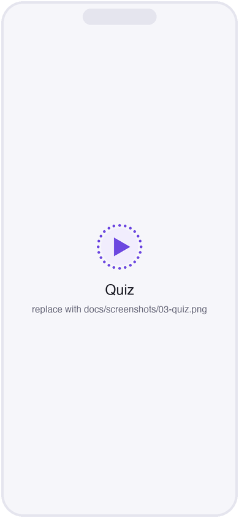
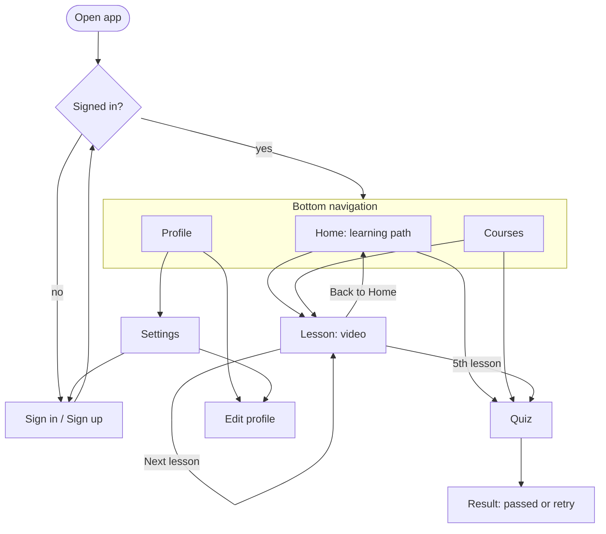
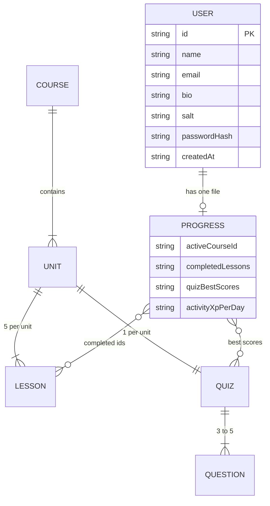

# OctoLearn — Video course mobile app (prototype)

[Монгол хувилбар](README.mn.md)

An app for online video courses, developed as a mobile app inspired by the Duolingo mobile app. The project is based on the OctoLearn company's Fullstack developer selection task and is built with **React Native (Expo) + TypeScript**.

The flow of using this app is:

1. Sign in to the app.
2. Choose a course you are interested in.
3. The chosen course shows its curriculum as a winding path.
4. After fully watching a lesson, you earn experience points (XP).
5. After every 5 lessons you take a quiz.
6. The user can see how much progress they have made, along with statistics, on the profile page.

## Screenshots

<!-- These are grey placeholders. Replace each file in docs/screenshots/ with a real screenshot of the same name. -->
<table>
  <tr>
    <td align="center"><br><sub>Home · learning path</sub></td>
    <td align="center"><br><sub>Lesson · video</sub></td>
    <td align="center"><br><sub>Quiz</sub></td>
  </tr>
  <tr>
    <td align="center"><br><sub>Courses</sub></td>
    <td align="center"><br><sub>Profile</sub></td>
    <td align="center"><br><sub>Settings</sub></td>
  </tr>
</table>

Demo video: _TODO: add the link here._

## To run this project, run the following commands

```bash
git clone https://github.com/anandleoo/octolearn/
cd octolearn
npm install
npx expo start
```

This project was run with Expo Go, so you can press `i` (iOS simulator) or `a` (Android emulator) to check it in an emulator, or scan the QR code with the **Expo Go** app on your phone.
Expo SDK 58 requires Node 22.13 or newer (although it also worked on Node 20, with a warning).

- **Demo account:** `demo@octolearn.mn` / `Demo1234`.
- **The sample videos are only 5–10 seconds long**, so a lesson can be finished in a few seconds.

## What is built

### Added beyond the assignment

- **Accounts:** a sign in / sign up page with a **"Remember me"** option. User data is stored in a small **JSON "database"** on the device (`src/db/userDb.ts`, initial data in `src/data/users.json`). The prototype needs no backend.
- **Courses tab:** switch between courses with a dropdown (or choose *no course*), a donut progress ring, search, a collapsible course outline, and the other courses. While no course is chosen, the Home page shows a "choose a course" page.
- **Profile + Edit profile + Settings:** badges, change name / email / bio, change password, light / dark / system theme, vibration feedback on/off, sign out, and a collapsible **danger zone** (reset progress, delete account; deleting asks for the password).
- **After a lesson:** the *Next lesson* button opens the next lesson and starts its video right away. The *Back to Home* button takes you to the Home page.
- **Error and loading states:** for *video failed to load*, *page failed to load*, *page not found* and *locked step* there is a hand-drawn illustration for each, plus skeleton (empty placeholder while loading) screens for Home, Courses, Profile and the video.
- **No-internet page:** when the internet drops, an illustrated "No internet connection" page replaces the video in a lesson, and its "Check again" button checks the connection again. As soon as the connection returns, the video reloads by itself. (You can view it directly under Settings → DEMO.)

  (The assignment suggests videos of 30 seconds to 2 minutes, so if you like, replace the links in `src/data/courses/*.json`. The allowed hosts are listed in `src/lib/security.ts`.)

## Actions carried out for the assignment

- **Passing a quiz:** a score of 60% or above passes. If you score lower, the quiz stays "active" and can be retaken.
- **Course progress** takes both lessons *and* quizzes into account.
- **Courses:** each course unlocks independently of the others. XP, level and streak are calculated as a total across all courses. Switching courses does not erase the progress you already made in earlier courses.
- **XP:** a lesson gives +10 XP and a quiz gives +20 XP. Quiz XP is given **only the first time you pass the quiz**. Re-watching a lesson you already finished gives no XP, so XP cannot be farmed by repeating.
- **Level:** every 100 XP raises your level (Level) by one.
- **Streak:** counts the consecutive days on which you signed in to this app and studied. If on a given day you have *not yet* watched a lesson, taken a quiz or done anything similar, yesterday's streak stays valid until midnight.
- **"90% watched":** counted from the seconds that were actually played. Dragging the lesson video player's scrub bar to the end does not count, and replaying the same part is not counted as watching it twice.
- **Average quiz score:** the average of the *best* score of each quiz taken.
- **Accounts are stored on the device** (JSON). User data is kept on the device in this form.

## Application structure

**Flow between pages**



**Data model: what is stored and what is calculated**



`USER` rows are stored in the JSON user database, and
`PROGRESS` is stored as one file per user.
`COURSE`, `UNIT`, `LESSON`, `QUIZ` and `QUESTION` are read-only content from `src/data/courses/*.json`.
**XP, level, streak, percentages and each lesson's locked / active / completed state are not stored (for now).** They are calculated from `PROGRESS` each time (`src/lib/progress.ts`). The reason for this choice is to prevent this information from drifting out of sync or being changed by hand.

## Architecture (in brief)

```
src/
  app/             Pages only (Expo Router).
  components/      ui/ (design system), pathway/, courses/, lesson/, quiz/, profile/, settings/,
                   navigation/, feedback/, illustrations/, skeletons/, auth/
  hooks/           Video playback, scrolling + bottom bar, helper hooks
  lib/             Pure logic with no user interface (UI): course content, progress rules, gamification, validation, security
  db/              The JSON user "database"
  store/           Zustand stores: auth, course progress (saved separately for each user account), settings, notifications (toast), confirmation dialog
  theme/           Colours (light + dark), fonts, spacing, motion settings
  data/            courses/*.json (the app's content) and users.json (the demo account)
```

1. **Store as little as possible, calculate the rest.** What is stored: the ids of watched lessons, the best quiz scores, a log of activity per day, and the chosen course. XP, level, streak and *which step of a course is locked* are calculated from this data and are not stored. The reason for not storing them is that the data cannot drift out of sync, and it makes opening a lesson by editing the saved file impossible; I implemented it from the simplest possible angle.
2. **Pure logic with no UI** (`src/lib`). It does not need a mobile app to run, so it can be checked with unit tests.
3. **One design system.** `AppText`, `Button`, `Card`, `Pill`, `DonutProgress`, `StateView`, `Sheet`, `Select`, `Reveal`,
   `PressableScale` and `Icon` (Lucide) are used on every page. Colours, fonts and spacing are defined only in `theme/`.
4. **Animations run on the UI thread**
   Entrance animations play only once per screen per session.
5. **Data lives under each user account.** Each user account has its own progress file, so even if several people with different accounts use one phone, they do not share XP.

## Not done / what I'd do with more time

- Create a real backend (Node.js + PostgreSQL) for user accounts, courses and progress. The data layer is isolated in `store/`, `db/` and `lib/`, so the swap is concentrated in one place.
- Full security and encryption. Today passwords are not encrypted, only hashed and stored (a password cannot be recovered from a hash). However, the account and the progress data (which lessons were watched) are stored unencrypted on the device. Going forward:
  - Passwords: hash on the server with argon2id (or bcrypt) using a different salt for each user, protected by an extra secret key (pepper). This will replace the current repeated SHA-256.
  - Sign-in: use short-lived access tokens + refresh tokens, limit too many attempts on the server (rate limit), and add email verification and two-factor authentication (2FA).
  - Encrypting content and user data (encryption at rest): store the user account and the progress information of *which courses and lessons were taken* encrypted on the device with AES-256-GCM (with the key in the Keychain / Keystore), and encrypt them in the server database too. All transmission goes over HTTPS (TLS).
  - Check answers on the server: keep the correct quiz answers and the scoring on the server instead of inside the app. Serve videos through signed, short-lived links.
- Offline mode: if there is time, I would build an offline mode where users can download a course in advance (storing the videos and quizzes on the device) and study even without internet. When the internet returns, progress is synced with the server. Today, when the internet drops, the app shows an illustrated "No internet connection" page with a "Check again" button.
- A fully working web version, publishing to the App Store / Google Play, and shuffling the quiz options (shuffle).

## AI usage

I used Claude Code (Anthropic) to build the project foundation (template), repetitive boilerplate code and the design. I provided the product and design direction (reference screens, which features to add or remove). I reviewed and checked the security-related parts myself. Since this is a prototype, it has no real backend protection. So, as a first step,
form input validation:

- Input validation (`src/lib/security.ts`): videos load only from an allow-listed set of hosts, over https. Route parameters, the name and the bio are sanitized.

- Password hashing (`src/lib/passwordHash.ts`): every password is hashed with SHA-256. The file's own comment calls this "prototype-grade" and states that a real backend would use argon2 or bcrypt.

- Session: "Remember me" keeps the session id and the email in the device's secure storage (Keychain/Keystore), and these are deleted when you sign out or delete the account.

## Technologies used

- Expo SDK 58
- React Native 0.88
- TypeScript (strict)
- Expo Router
- Reanimated 4
- expo-video
- expo-blur
- expo-secure-store
- expo-crypto
- Zustand + AsyncStorage
- react-native-svg
- Lucide icons
- Nunito font
- Jest
