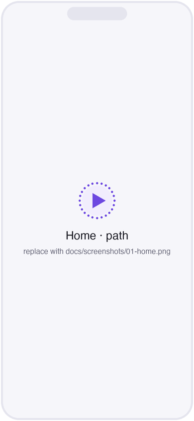
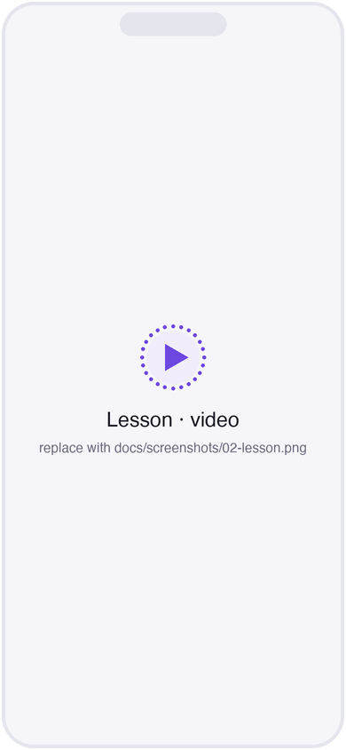
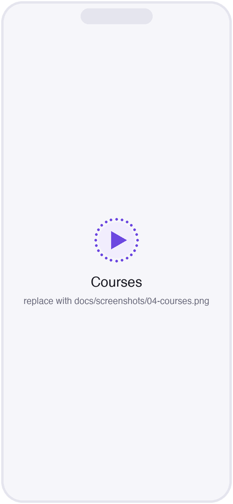
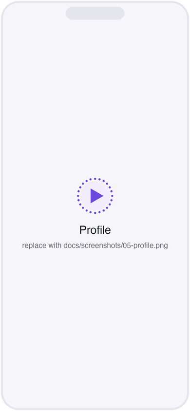
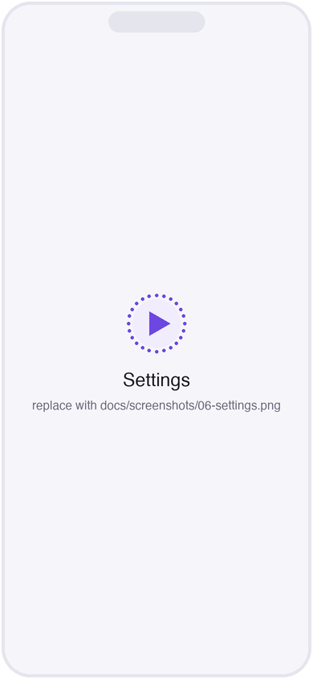
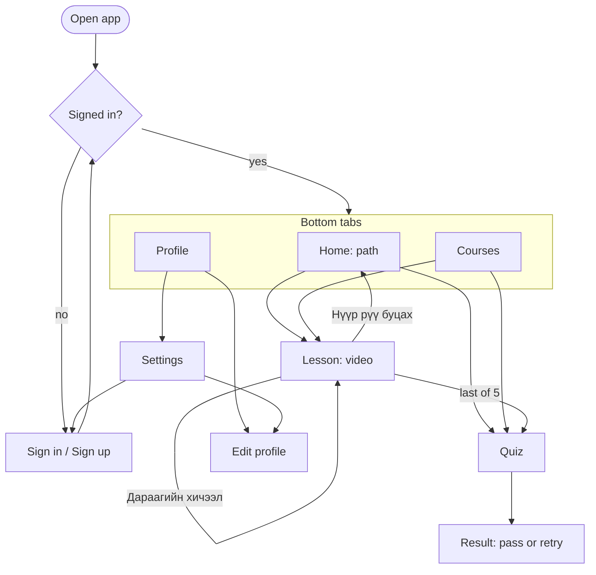
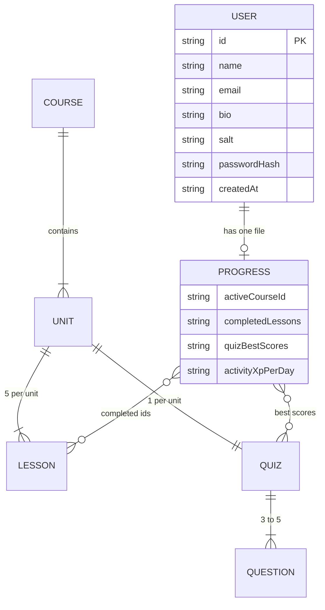

# OctoLearn — Video Course Mobile App (prototype)

[Монгол хувилбар](README.mn.md)

A Duolingo-style learning path for video courses, built with **React Native (Expo) + TypeScript**
for the OctoLearn Fullstack selection task.

Sign in → pick a course → walk a zig-zag path of lessons → watch a short video → finish it for XP →
pass a quiz after every 5 lessons → see your stats on the Profile tab. Everything is saved on the
device and survives closing the app.

> Plain-language tour of the code: [docs/WALKTHROUGH.md](docs/WALKTHROUGH.md)

## Screenshots

<!-- These are grey placeholders. Replace each file in docs/screenshots/ with a real screenshot of the same name. -->
<table>
  <tr>
    <td align="center"><br><sub>Home · path</sub></td>
    <td align="center"><br><sub>Lesson · video</sub></td>
    <td align="center"><br><sub>Quiz</sub></td>
  </tr>
  <tr>
    <td align="center"><br><sub>Courses</sub></td>
    <td align="center"><br><sub>Profile</sub></td>
    <td align="center"><br><sub>Settings</sub></td>
  </tr>
</table>

Demo video: _TODO: add the link here._

## Quick start for reviewers

```bash
git clone <this repo>
cd octolearn
npm install
npx expo start
```

Press `i` (iOS simulator), `a` (Android emulator), or scan the QR code with **Expo Go** on a phone.
Expo SDK 58 asks for Node 22.13+ (it also starts on Node 20 here, with a warning).

- **Demo account:** `demo@octolearn.mn` / `Demo1234` (or create your own on the sign-up page).
- **Sample videos are only 5–10 seconds long**, so a lesson takes seconds to finish.
  (The brief suggests 30 s – 2 min; swap the links in `src/data/courses/*.json`. Hosts are allow-listed in `src/lib/security.ts`.)
- **Start over any time:** Profile → gear → Settings → open **АЮУЛТАЙ БҮС** → *Ахиц дахин эхлүүлэх*.
- **See every error / loading page on demand:** Settings → **ДЕМО · АЛДАА БА АЧААЛЛЫН ТӨЛӨВ**.

A 2-minute test path: sign in → *Курс сонгох* → open the first lesson → let the video play to the end →
**Дуусгах** (+10 XP) → **Дараагийн хичээл** → finish 5 lessons → take the quiz (3 of 5 correct passes) → check Profile.

```bash
npm test            # 39 unit tests: unlock rules, XP, quiz pass rule, course switching, validation, user DB, search
npm run typecheck   # TypeScript, strict mode
npm run lint
```

### Build an installable Android APK

```bash
npx eas-cli login
npx eas-cli build -p android --profile preview    # "preview" in eas.json builds an .apk you can install directly
```

## What is built

### Brief checklist

| Brief item | Status |
|---|---|
| **P0** Pathway: zig-zag path, units with titles, 3 node states, quiz node with a different shape, locked-tap message | Done |
| **P0** Top progress bar (`N / M алхам · %`) + total XP | Done |
| **P0** Video lesson: play/pause, seek, "Бүлэг · Хичээл n / 5", description, **Дуусгах** unlocks at 90% watched, "+10 XP", next lesson unlocks, back keeps the lesson active | Done |
| **P0** MCQ quiz: 5 questions × 3 options, progress bar, check → green/red + the right answer, result screen with Continue / Retry, pass at 60% | Done |
| **P0** Profile: name, avatar initial, XP, lessons done, quizzes passed, average score, course progress, level | Done |
| **P0** Bottom tabs + progress saved on the device | Done |
| **P1** Auto-scroll to the active lesson, streak, animated progress bar, fullscreen video, reset button | Done |
| **P2** Weekly activity chart, level logic, dark mode, unit tests, state management (Zustand), loading / empty / error states | Done |
| **P2** Backend, Lottie/Rive, web build, store builds | Not done (see below) |

Content (all in `src/data/courses/*.json`): **3 courses, 7 units, 35 lessons, 7 quizzes.**
English A1 (3 units), English A2 (2 units), Japanese A1 (2 units). Inside a course, units unlock in order.

### Beyond the brief

- **Accounts:** sign in / sign up with **Remember me**, stored in a small **JSON "database"** on the device (`src/db/userDb.ts`, seeded from `src/data/users.json`). No backend needed for the prototype.
- **Courses tab:** switch between courses with a dropdown (or choose *no course*), a donut progress ring, a collapsible course outline with **search**, and the other courses. Until a course is chosen, Home shows a "choose a course" page.
- **Profile + Edit profile + Settings:** badges, change name / email / bio, change password, light / dark / system theme, vibration toggle, sign out, and a collapsible **danger zone** (reset progress, delete account, which asks for the password).
- **After a lesson:** *Дараагийн хичээл* opens the next lesson and starts the video; *Нүүр рүү буцах* goes Home.
- **Polish:** a large page title that shrinks into a slim pinned bar while scrolling (Home, Courses, Profile), floating tab bar that expands / collapses, blurred pop-ups instead of system alerts, light toasts above the tab bar, haptics.
- **Error and loading states:** custom hand-drawn illustrations for *video failed to load*, *page failed to load*, *page not found* and *locked step*, plus skeleton screens for Home, Courses, Profile and the video.

## Decisions I made where the brief was open

- **Pass rule:** 60% or higher passes (the brief's suggestion). Below that the quiz stays active and can be retaken.
- **Course progress** counts lessons *and* quizzes (18 steps in English A1), because the bar must also update after a quiz. The label says "алхам" (steps).
- **Several courses:** each course unlocks on its own, while XP, level and streak add up across all of them. Switching courses never removes completed work.
- **XP:** lesson +10, quiz +20. Quiz XP is awarded **only the first time you pass**, and replaying a finished lesson gives nothing, so XP can't be farmed.
- **Level:** every 100 XP is one level.
- **Streak:** consecutive days with any activity. If you haven't done anything *yet today*, yesterday's streak stays alive until midnight.
- **"Watched 90%":** counted from genuinely played half-second pieces. Dragging the seek bar to the end does not count, and replaying the same part twice does not count twice.
- **Average quiz score:** average of the *best* score of each quiz attempted.
- **Accounts live on the device** (JSON), not on a server: the brief says a backend is optional.

## How the app fits together

**Screen flow**



**Data model: what is saved, and what is calculated**



`USER` rows live in the JSON user database and `PROGRESS` is one file per user, both on the device. `COURSE`, `UNIT`,
`LESSON`, `QUIZ` and `QUESTION` are read-only content from `src/data/courses/*.json`.
**XP, level, streak, percentages and every lock / active / completed state are never saved:** they are calculated from `PROGRESS`
each time (`src/lib/progress.ts`), so they cannot get out of sync or be edited into existence.

## Architecture (the short version)

```
src/
  app/             Screens only (Expo Router file-based routes), kept thin
  components/      ui/ (design system), pathway/, courses/, lesson/, quiz/, profile/, settings/,
                   navigation/, feedback/, illustrations/, skeletons/, auth/
  hooks/           Video playback, scroll + tab-bar collapse, helpers
  lib/             Pure logic with no UI: curriculum, progress rules, gamification, validation, security
  db/              The JSON user "database"
  store/           Zustand stores: auth, progress (saved per account), settings, toast, confirm dialog
  theme/           Colours (light + dark), fonts, spacing, motion settings
  data/            courses/*.json (content) and users.json (demo account)
```

1. **Store the minimum, derive the rest.** Saved: completed lesson ids, best quiz scores, a per-day activity log
   and the chosen course. XP, level, streak, percentages and *which step is locked* are always calculated from those,
   so they can never drift out of sync and nobody can unlock a lesson by editing the saved file.
2. **Pure logic is separate from UI** (`src/lib`), so it is unit-tested without a phone.
3. **One design system.** `AppText`, `Button`, `Card`, `Pill`, `DonutProgress`, `StateView`, `Sheet`, `Select`, `Reveal`,
   `PressableScale`, `Icon` (Lucide) are used on every screen; colours, fonts and spacing live only in `theme/`.
4. **Animations run on the UI thread** (Reanimated) and are deliberately calm (timing, no springy overshoot).
   Entrance animations play once per screen per session.
5. **Data is per account.** Each account has its own progress file; XP is never shared between people on one phone.

## Security and robustness

This is a client-only prototype, so "secure" means *hard to break and hard to cheat by accident*, not impossible to tamper with.

- **Saved data is never trusted.** Progress and the user database are rebuilt field by field when loaded
  (`sanitizeProgress`, `sanitizeUsers`): unknown ids, wrong types, out-of-range numbers and forged "completed" steps are dropped.
- **Rules live in the store, not just the buttons:** locked steps, impossible scores and double submissions are refused.
- **Route guards:** signed-out users cannot open any app screen (`Stack.Protected`), and `StepGate` stops a deep link such as
  `octolearn://lesson/u3-l5` from skipping the path.
- **Passwords** are never stored, only a random salt + repeated SHA-256 (prototype-grade; a real backend would use argon2/bcrypt).
  Sign-in errors are generic, and 5 wrong tries lock that email for a while.
- **Session** (Remember me) is kept in the OS secure store (Keychain / Keystore).
- **Video URLs** must be `https` on an allow-listed host. **Course JSON** is validated at start-up.
- **Crash safety:** an error boundary shows a friendly page and never a stack trace. Android `allowBackup: false`.
- **Limits, honestly:** AsyncStorage is not encrypted and the quiz answers ship inside the app. Anything that matters
  (paid content, certificates) would need a server.

## Not done / what I'd do with more time

- A real backend (Node.js + PostgreSQL) for accounts, courses and progress. The data layer is isolated in `store/`, `db/` and `lib/`, so the swap is contained.
- Offline detection (a banner). Today a video that can't load shows an error page with a Retry button.
- Real blur behind pop-ups on Android (it uses a dimmed backdrop there; iOS has the true blur).
- Lottie/Rive animations, a web build, store builds, shuffling quiz options, component and screenshot tests.

## Time spent

> TODO: write your real number of hours here.

## AI usage

> TODO: check this matches what you did; the brief says to state where AI was used and to be able to explain all the code.

I used **Claude Code** (Anthropic) throughout. It scaffolded the Expo project and wrote most of the components,
the progress / security / auth logic, the unit tests and this README. I gave the product and design direction
(reference screenshots, tab-bar and header behaviour, which features to add or remove) and reviewed the results.

> TODO: add what you personally tested on a device and the parts you wrote or changed by hand.

## Tech

Expo SDK 58 · React Native 0.88 · TypeScript (strict) · Expo Router · Reanimated 4 · expo-video · expo-blur ·
expo-secure-store · expo-crypto · Zustand + AsyncStorage · react-native-svg · Lucide icons ·
Nunito font (supports Mongolian Cyrillic, including Ү and Ө) · Jest.
