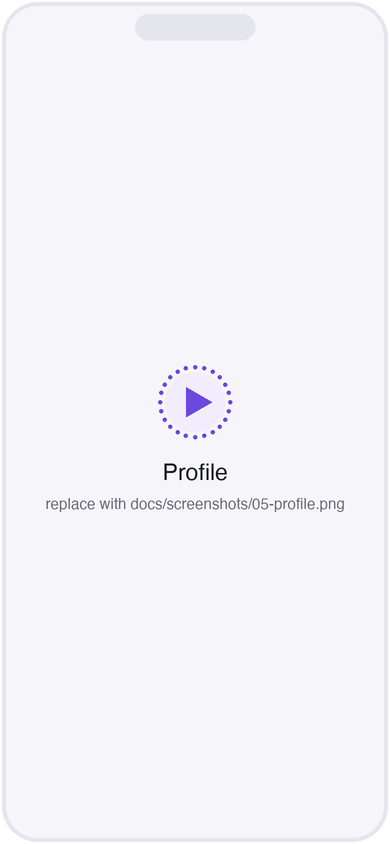
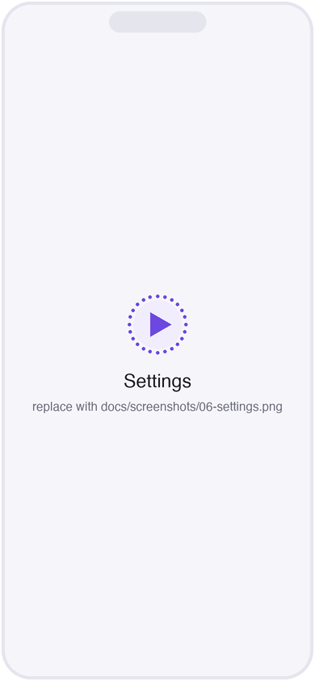
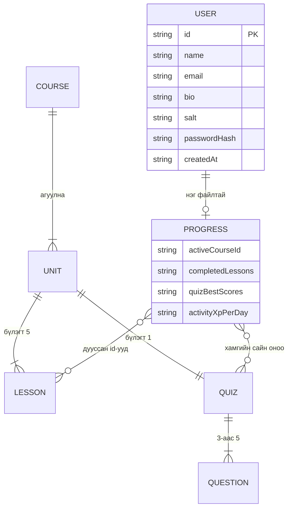

# OctoLearn — Видео хичээлийн мобайл апп prototype(прототип)

[English version](README.md)

Онлайн видео хичээлд зориулсан, Duolingo гар утасны аппликейшнаас санаа аван уг гар утасны аппликейшн дээр хөгжүүлэлт хийлээ. Уг төсөл нь OctoLearn компанийн Fullstack хөгжүүлэгчийн сонгон шалгаруулалтын даалгавар дээр үндэслэгдсэн бөгөөд **React Native (Expo) + TypeScript** -г хэрэглэсэн болно.


Энэхүү аппликейн руу хандах урсгал бол
 Аппликейшн нэвтрэн орно 
 Өөрийн сонирхсон хичээлийг сонгоно 
 Сонгосон хичээл нь мушгирсан зам хэлбэрээр хичээлийн хөтөлбөрийг харуулна 
 Тухайн хичээлийн агуулгийг бүрэн бүтэн үзсэн хойно туршлагийн оноо (XP) авна 
 5 хичээл тутмын дараа шалгалт өгнө
 Хэрэглэгч хэр ахицтай байгаа, статистик мэдээллийг профайл хуудсаас харах боломжтой

## Дэлгэцийн зургууд

<!-- Эдгээр нь түр саарал зургууд. docs/screenshots/ дотор ижил нэртэй жинхэнэ дэлгэцийн зургаар сольж тавина. -->
<table>
  <tr>
    <td align="center"><br><sub>Нүүр · суралцах зам</sub></td>
    <td align="center"><br><sub>Хичээл · видео</sub></td>
    <td align="center"><br><sub>Шалгалт</sub></td>
  </tr>
  <tr>
    <td align="center"><br><sub>Хичээлүүд</sub></td>
    <td align="center"><br><sub>Профайл</sub></td>
    <td align="center"><br><sub>Тохиргоо</sub></td>
  </tr>
</table>

Демо видео: _TODO: холбоосыг энд нэмнэ._

## Энэхүү төслийг ажиллагаанд оруулахын тулд эдгээр коммандуудыг ажиллуулна.

```bash
git clone https://github.com/anandleoo/octolearn/
cd octolearn
npm install
npx expo start
```

Энэ төслийг Expo Go дээр гүйцэтгэсэн тул  `i` (iOS симулятор), `a` (Android эмулятор) дээр даран (emulator) дээр шалгах эсвэл утсан дээрээ **Expo Go** аппаар QR кодыг уншуулан ажиллуулна.
Expo SDK 58  хувилбар нь Node 22.13 ба түүнээс дээш хувилбар шаарддаг ( хэдий ч Node 20 дээр ч анхааруулгатайгаар ажилласан).

- **Туршилтын бүртгэл:** `demo@octolearn.mn` / `Demo1234`. 
- - **Жишиг видеонууд ердөө 5–10 секунд** урт тул нэг хичээлийг хэдхэн секундэд дуусгаж болно.

## Юу хийгдсэн бэ

### Даалгавраас гадна нэмсэн зүйлс

- **Бүртгэл:** нэвтрэх / бүртгүүлэх хуудас, **«Намайг сана»** сонголттой. Хэрэглэгчийн мэдээллийг төхөөрөмж дээрх жижиг **JSON "мэдээллийн сан"**-д хадгална (`src/db/userDb.ts`, анхны өгөгдөл нь `src/data/users.json`). Прототипэд backend шаардлагагүй.
- **Хичээлүүд хэсэг:** курс хооронд цэсээр (эсвэл *курсгүй* гэж) шилжих, дугуй (donut) ахицын хэмжүүр, хайлттай, нээж хаадаг курсийн агуулга, бусад курсүүд. Курс сонгоогүй үед Нүүр хуудас "курсээ сонгоно уу" гэсэн хуудас харуулна.
- **Профайл + Профайл засах + Тохиргоо:** амжилтын тэмдгүүд (badge), нэр / имэйл / тайлбар солих, нууц үг солих, цайвар / харанхуй / системийн загвар, чичиргээний хариу асаах/унтраах, системээс гарах, мөн нээж хаадаг **аюултай бүс** (ахиц дахин эхлүүлэх, бүртгэл устгах. Устгахдаа нууц үг асууна).
- **Хичээл дууссаны дараа:** *Дараагийн хичээл* товч дараагийн хичээлийг нээж видеог нь шууд тоглуулна. *Нүүр рүү буцах* товч Нүүр хуудас руу аваачна.
- **Алдаа болон ачааллын төлөв:** *видео ачаалагдсангүй*, *хуудас ачаалагдсангүй*, *хуудас олдсонгүй*, *түгжээтэй алхам* гэсэн төлөв бүрт өөрийн гараар зурсан зураг, мөн Нүүр, Хичээлүүд, Профайл болон видеонд зориулсан skeleton (ачаалах үеийн хоосон хүрээ) дэлгэцүүд.](https://github.com/anandleoo/octolearn/blob/main/README.md


  (Даалгавар дээр 30 секунд – 2 минутын видеог санал болгосон тул . Хүсвэл `src/data/courses/*.json` доторх холбоосыг солино. Зөвшөөрөгдсөн хостуудыг `src/lib/security.ts` файлд жагсаасан.)

## Даалгавар хэсэг дээр биелүүлсэн үйлдлүүд

- **Шалгалтад тэнцэх үйлдэл:** Шалгалтад 60% ба түүнээс дээш бол тэнцэнэ. Түүнээс доош оноо авсан бол шалгалт "идэвхтэй" хэвээр үлдэж,  шалгалтыг дахин өгөх боломжтой.
- **Хичээлийн ахиц** нь хичээл *болон* шалгалт хоёр хоёулаа хамаарагдана. 
- **Хичээлүүд:** Хичээл бүр бусдаасаа тусдаа нээгдэнэ. Харин XP, түвшин, streak нь бүх хичээлийн нийлбэрээр тооцогдоно. Хичээл солисон ч гэсэн өмнө нь үзсэн хичээлийн прогресс ахиц арилахгүй.
- **XP:** хичээл +10, шалгалт +20 XP өгнө. Шалгалтын XP-г **Шалгалтыг эхний удаа өгөхөд л** өгнө. Аль хэдийн үзсэн хичээлийг дахин үзэхэд XP өгөхгүй тул XP-г давтаж хуурч авах боломжгүй болно.
- **Түвшин:** 100 XP тутамд нэг түвшин(Level) ахина.
- **Streak:** Өдөр болгон энэ аппликейшн руу нэвтрэн хичээл үзсэн  өдрүүдийг  тоолно. Хэрэв тухайн өдөр *хараахан* хичээл үзээгүй, шалгалт өгөөгүй гэх мэт үйлдлүүд хийгээгүй бол өчигдрийн streak шөнө дунд болтол хүчинтэй хэвээр байна.
- **"90% үзсэн":** Үнэхээр тоглогдсон  секундийн хэсгүүдээс тоолно. Хичээлийн видео тоглуулагчын гүйлгэх мөрийг төгсгөл рүү чирэхэд тооцогдохгүй, мөн нэг хэсгийг дахин үзэх нь хоёр үзсэн гэж тоологдохгүй.
- **Шалгалтын дундаж оноо:** Өгсөн шалгалт бүрийн *хамгийн сайн* онооны дундаж оноог гаргана.
- **Бүртгэл төхөөрөмж дээр хадгалагдана** (JSON). хэлбэрээр өгөгдлийг төхөөрөмж дээр хэрэглэгчийн мэдээллийг хадгална

## Аппликейшн бүтэц

**Хуудас хоорондын урсгал**


**Өгөгдлийн загвар: юуг хадгалдаг, юуг тооцоолдог**



`USER` мөрүүд JSON хэрэглэгчийн өгөгдлийн санд хадгална,
 `PROGRESS` нь хэрэглэгч бүрт нэг файл хэлбэрээр  хадгална.
 `COURSE`, `UNIT`, `LESSON`, `QUIZ`, `QUESTION` нь `src/data/courses/*.json` доторх зөвхөн унших (read-only) агуулга юм.
**XP, түвшин, streak, хувь болон хичээл бүрийн түгжээтэй / идэвхтэй / дууссан төлөв нь одоохондоо хадгалагдаагүй.** Эдгээрийг `PROGRESS`-оос тус бүрт нь тооцоолно. (`src/lib/progress.ts`). Сонгосон шалтгаан нь энэ мэдээлэл зөрөх, эсвэл гараар аргаар өөрчлөхөөс сэргийллээ.

## Архитектур (товчхон)

```
src/
  app/             Зөвхөн хуудаснууд (Expo Router). 
  components/      ui/ (дизайн систем), pathway/, courses/, lesson/, quiz/, profile/, settings/,
                   navigation/, feedback/, illustrations/, skeletons/, auth/
  hooks/           Видео тоглуулалт, гүйлгэлт + доод самбар, туслах hook-ууд
  lib/             Хэрэглэгчийн интерфейс(UI)-гүй цэвэр логик: хичээлийн агуулга, ахиц прогрессын дүрэм, тоглоомжуулалт, баталгаажуулалт, аюулгүй байдал
  db/              JSON хэрэглэгчийн "өгөгдлийн сан"
  store/           Zustand дэлгүүрүүд: хамгаалалт(auth),  хичээлийн ахиц (хэрэглэгчийн хаяг бүрт тусад нь хадгална), тохиргоо, мэдэгдэл(toast) , баталгаажуулах цонх
  theme/           Өнгө (цайвар + харанхуй), фонт, зай, хөдөлгөөний тохиргоо
  data/            courses/*.json (Аппликейшны агуулга) ба users.json (туршилтын хаяг)
```
1. **Аль болох бага мэдээлэл хадгалж, бусдыг тооцоолно.** Хадгалах үйлдэл агуулсан үйлдлүүд: Үзсэн хичээлийн id-ууд, шалгалтын хамгийн сайн оноо, өдөр бүрийн идэвхийн бүртгэл, сонгосон хичээл. Харин XP, түвшин, streak эдгээр өгөгдлүүдийг хичээлийн *аль алхам түгжээтэй вэ* гэдгийг   тооцоолдох бөгөөд энэ талбарын мэдээллүүд хадгалагдахгүй. Мэдээлэл хадгалдаггүй болсон шалтгаан нь өгөгдөл хооронд мэдээлэл зөрөхгүй бөгөөд хадгалсан файлыг засаж хичээл нээх боломжгүй болгох аль болох энгийн өнцөгөөс хэрэгжүүллээ.
2. **Цэвэр логик бөгөөд UI-гүй үйлдэл** (`src/lib`), Гар утасны аппликейшн шаардахгүй тул unit тестээр шалгаж болно.
3. **Нэг дизайн систем.** `AppText`, `Button`, `Card`, `Pill`, `DonutProgress`, `StateView`, `Sheet`, `Select`, `Reveal`,
   `PressableScale`, `Icon` (Lucide) нь бүх хуудсан дээр ашиглагдана. Өнгө, фонт, зайг зөвхөн `theme/`-д тодорхойлсон.
4. **Анимэйшнүүд UI thread дээр ажиллана** 
   Нэвтрэх анимэйшн нь нэг дэлгэц дээр нэг сессэд нэг л удаа тоглогдоно.
5. **Өгөгдөл нь хэрэглэгчийн хаяг тус бүрт байрлана.** Хэрэглэгчийн хаяг тус бүр өөр өөрийн ахиц прогрессын файлтай тул нэг утсыг өөр бүртгэлтэй хэдэн хүн хэрэглэсэн ч XP хуваалцахгүй.


## Хийгдээгүй зүйлс / илүү цаг гарвал хийх зүйлс

- Хэрэглэгчийн хаяг, хичээл, ахицад зориулсан жинхэнэ backend (Node.js + PostgreSQL)  үүсгэх. Өгөгдлийн давхарга `store/`, `db/`, `lib/` дотор тусгаарлагдсан тул солих ажил(swap) нэг дор төвлөрнө.
- Интернэтгүй байдлыг илрүүлэх. Одоогоор видео ачааллахгүй тохиолдолд  алдааны хуудас харуулах бөгөөд энэ хуудсан дээр "Дахин оролдох" товч байрлана.
-Бүрэн бүтэн ажиллагаанд орсон веб хувилбар, app/play store-ийн дээр байрлуулах, шалгалтын агуулга сэлгэж холих(shuffle) 

## AI ашигласан байдал
Би Claude Code (Anthropic)-ийг төслийн суурь (template), давтагдах boilerplate код болон дизайныг хэрэгжүүлэхэд ашигласан. Бүтээгдэхүүн болон дизайны чиглэлийг (жишиг дэлгэцүүд, ямар боломж нэмэх, хасах) би өгсөн. Аюулгүй байдалтай холбоотой хэсгийг би өөрөө хянаж шалгасан.  Энэ нь прототип тул жинхэнэ backend-ийн хамгаалалт байхгүй. Иймд анхны шат гэх үүднээс 
input форм шалгах

- Оролтын(Input) шалгалт (src/lib/security.ts): Видео зөвхөн зөвшөөрөгдсөн хостын жагсаалтаас, https-ээр ачаалагдана. Route параметр, нэр болон намтар (bio)-ыг цэвэрлэгдэнэ (sanitized)

- Нууц үг хэшлэх(hash) (src/lib/passwordHash.ts): нууц үг бүр SHA-256-аар хэшлэгдэнэ. Файлын тайлбарт өөрт нь үүнийг "прототип түвшний" гэж бичсэн бөгөөд жинхэнэ backend argon2 эсвэл bcrypt ашиглана гэж заасан.

- Сешн(Session):"Намайг сана" үйлдлийн сешний id болон имэйлийн мэдээлийиг төхөөрөмжийн аюулгүй хадгалалтад (Keychain/Keystore) хадгалдаг бөгөөд аппликейшнаас гарах эсвэл бүртгэл устгахад эдгээр устна.


## Ашигласан технологи

Expo SDK 58
React Native 0.88 
TypeScript (strict) 
Expo Router 
Reanimated 4 
expo-video 
expo-blur 
expo-secure-store 
expo-crypto 
Zustand + AsyncStorage 
react-native-svg 
Lucide icons
Nunito font  
Jest.
