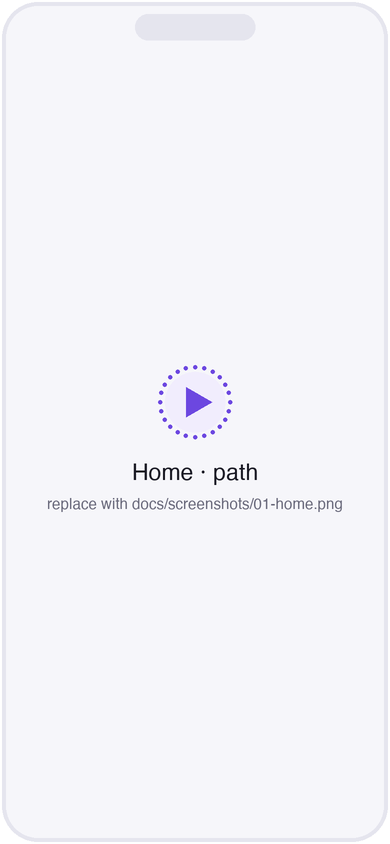
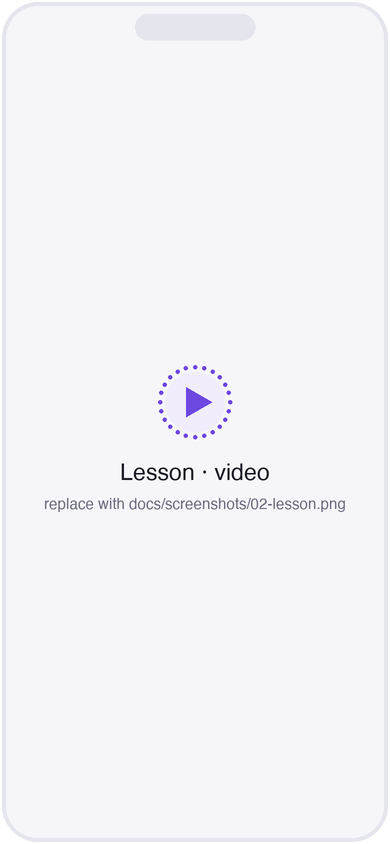
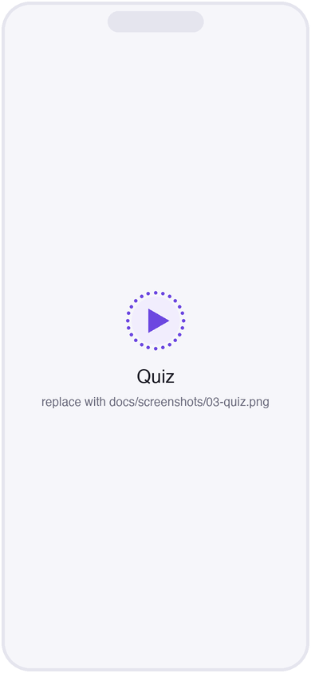
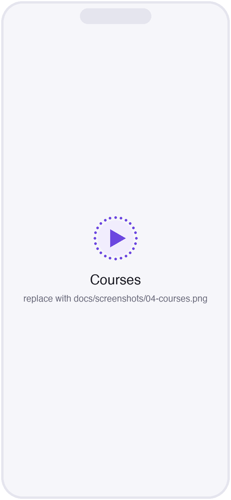
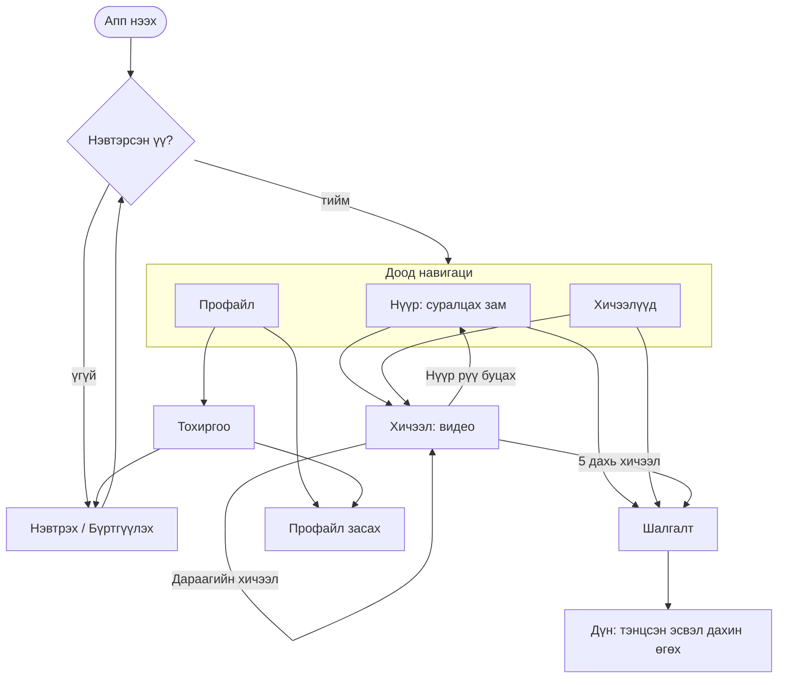
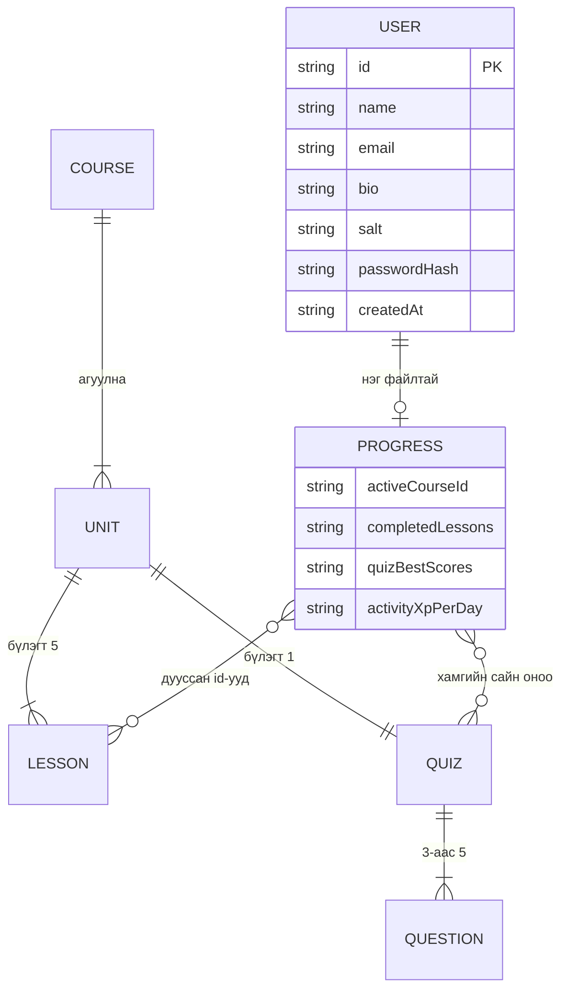

# OctoLearn — Видео хичээлийн мобайл апп prototype(прототип)

[English version](README.md)

Онлайн видео хичээлд зориулсан, Duolingo гар утасны аппликейшнаас санаа аван уг гар утасны аппликейшн дээр хөгжүүлэлт хийлээ. Уг төсөл нь OctoLearn компанийн Fullstack хөгжүүлэгчийн сонгон шалгаруулалтын даалгавар дээр үндэслэгдсэн бөгөөд **React Native (Expo) + TypeScript** -г хэрэглэсэн болно.


Энэхүү аппликейн руу хандах урсгал бол
 Аппликейшн нэвтрэн орно 
 Өөрийн сонирхсон хичээлийг сонгоно 
 Сонгосон хичээл нь мушгирсан зам хэлбэрээр хичээлийн хөтөлбөрийг харуулна 
 Тухайн хичээлийн агуулгийг бүрэн бүтэн үзсэн хойно туршлагийн оноо (XP) авна 
 5 хичээл тутмын дараа шалгалт өгнө
 Хэрэглэгч хэр ахицтай байгаа, статистик мэдээллийг профайл хуудсаас харах боломжтой

## Дэлгэцийн зургууд

<!-- Эдгээр нь түр саарал зургууд. docs/screenshots/ дотор ижил нэртэй жинхэнэ дэлгэцийн зургаар сольж тавина. -->
<table>
  <tr>
    <td align="center"><br><sub>Нүүр · суралцах зам</sub></td>
    <td align="center"><br><sub>Хичээл · видео</sub></td>
    <td align="center"><br><sub>Шалгалт</sub></td>
  </tr>
  <tr>
    <td align="center"><br><sub>Хичээлүүд</sub></td>
    <td align="center"><br><sub>Профайл</sub></td>
    <td align="center"><br><sub>Тохиргоо</sub></td>
  </tr>
</table>

Демо видео: _TODO: холбоосыг энд нэмнэ._

## Энэхүү төслийг ажиллагаанд оруулахын тулд эдгээр коммандуудыг ажиллуулна.

```bash
git clone https://github.com/anandleoo/octolearn/
cd octolearn
npm install
npx expo start
```

Энэ төслийг Expo Go дээр гүйцэтгэсэн тул  `i` (iOS симулятор), `a` (Android эмулятор) дээр даран (emulator) дээр шалгах эсвэл утсан дээрээ **Expo Go** аппаар QR кодыг уншуулан ажиллуулна.
Expo SDK 58  хувилбар нь Node 22.13 ба түүнээс дээш хувилбар шаарддаг ( хэдий ч Node 20 дээр ч анхааруулгатайгаар ажилласан).

- **Туршилтын бүртгэл:** `demo@octolearn.mn` / `Demo1234`. 
- - **Жишиг видеонууд ердөө 5–10 секунд** урт тул нэг хичээлийг хэдхэн секундэд дуусгаж болно.

## Юу хийгдсэн бэ

### Даалгавраас гадна нэмсэн зүйлс

- **Бүртгэл:** нэвтрэх / бүртгүүлэх хуудас, **«Намайг сана»** сонголттой. Хэрэглэгчийн мэдээллийг төхөөрөмж дээрх жижиг **JSON "мэдээллийн сан"**-д хадгална (`src/db/userDb.ts`, анхны өгөгдөл нь `src/data/users.json`). Прототипэд backend шаардлагагүй.
- **Хичээлүүд хэсэг:** курс хооронд цэсээр (эсвэл *курсгүй* гэж) шилжих, дугуй (donut) ахицын хэмжүүр, хайлттай, нээж хаадаг курсийн агуулга, бусад курсүүд. Курс сонгоогүй үед Нүүр хуудас "курсээ сонгоно уу" гэсэн хуудас харуулна.
- **Профайл + Профайл засах + Тохиргоо:** амжилтын тэмдгүүд (badge), нэр / имэйл / тайлбар солих, нууц үг солих, цайвар / харанхуй / системийн загвар, чичиргээний хариу асаах/унтраах, системээс гарах, мөн нээж хаадаг **аюултай бүс** (ахиц дахин эхлүүлэх, бүртгэл устгах. Устгахдаа нууц үг асууна).
- **Хичээл дууссаны дараа:** *Дараагийн хичээл* товч дараагийн хичээлийг нээж видеог нь шууд тоглуулна. *Нүүр рүү буцах* товч Нүүр хуудас руу аваачна.
- **Алдаа болон ачааллын төлөв:** *видео ачаалагдсангүй*, *хуудас ачаалагдсангүй*, *хуудас олдсонгүй*, *түгжээтэй алхам* гэсэн төлөв бүрт өөрийн гараар зурсан зураг, мөн Нүүр, Хичээлүүд, Профайл болон видеонд зориулсан skeleton (ачаалах үеийн хоосон хүрээ) дэлгэцүүд.

## Даалгавар нээлттэй орхисон хэсэгт гаргасан шийдвэрүүд

- **Тэнцэх дүрэм:** 60% ба түүнээс дээш бол тэнцэнэ (даалгаврын санал болгосон дүрэм). Түүнээс доош бол шалгалт "идэвхтэй" хэвээр үлдэж, дахин өгөх боломжтой.
- **Курсийн ахиц** нь хичээл *болон* шалгалтыг хоёуланг нь тоолно (Англи хэл A1 дээр нийт 18 алхам). Учир нь шалгалтын дараа ч прогресс бар шинэчлэгдэх ёстой. Тиймээс шошгыг "алхам" гэж бичсэн.
- **Олон курс:** курс бүр бусдаасаа тусдаа нээгдэнэ. Харин XP, түвшин, streak нь бүх курсийн нийлбэрээр тооцогдоно. Курс солиход дуусгасан ажил хэзээ ч устахгүй.
- **XP:** хичээл +10, шалгалт +20. Шалгалтын XP-г **эхний удаа тэнцэхэд л** өгнө. Дууссан хичээлийг дахин үзэхэд XP өгөхгүй тул XP-г давтаж хуурч авах боломжгүй.
- **Түвшин:** 100 XP тутамд нэг түвшин.
- **Streak:** ямар нэг үйлдэл хийсэн өдрүүдийг дараалуулан тоолно. Өнөөдөр *хараахан* юу ч хийгээгүй бол өчигдрийн streak шөнө дунд болтол хүчинтэй хэвээр байна.
- **"90% үзсэн":** үнэхээр тоглогдсон хагас секундийн хэсгүүдээс тоолно. Гүйлгэх мөрийг төгсгөл рүү чирэх нь тоологдохгүй, мөн нэг хэсгийг дахин үзэх нь хоёр дахин тоологдохгүй.
- **Шалгалтын дундаж оноо:** өгсөн шалгалт бүрийн *хамгийн сайн* оноог дундажилна.
- **Бүртгэл төхөөрөмж дээр хадгалагдана** (JSON), сервер дээр биш. Учир нь даалгавар backend-ийг заавал шаардаагүй.

## Апп хэрхэн бүтсэн бэ

**Дэлгэцүүдийн урсгал**



**Өгөгдлийн загвар: юуг хадгалдаг, юуг тооцоолдог**



`USER` мөрүүд JSON хэрэглэгчийн мэдээллийн санд, `PROGRESS` нь хэрэглэгч бүрт нэг файл байдлаар хадгалагдах бөгөөд хоёулаа төхөөрөмж дээр байна. `COURSE`, `UNIT`, `LESSON`, `QUIZ`, `QUESTION` нь `src/data/courses/*.json` доторх зөвхөн унших агуулга юм.
**XP, түвшин, streak, хувь болон хичээл бүрийн түгжээтэй / идэвхтэй / дууссан төлөвийг хэзээ ч хадгалдаггүй.** Эдгээрийг `PROGRESS`-оос тухай бүрт нь тооцоолдог (`src/lib/progress.ts`). Тиймээс тэдгээр нь зөрөх, эсвэл гараар засаж бий болгох боломжгүй.

## Архитектур (товчхон)

```
src/
  app/             Зөвхөн дэлгэцүүд (Expo Router, файлаар чиглүүлэлт). Нимгэн байлгасан
  components/      ui/ (дизайн систем), pathway/, courses/, lesson/, quiz/, profile/, settings/,
                   navigation/, feedback/, illustrations/, skeletons/, auth/
  hooks/           Видео тоглуулалт, гүйлгэлт + доод самбарын хураагдал, туслах hook-ууд
  lib/             UI-гүй цэвэр логик: хөтөлбөр, ахицын дүрэм, gamification, баталгаажуулалт, аюулгүй байдал
  db/              JSON хэрэглэгчийн "мэдээллийн сан"
  store/           Zustand store-ууд: auth, ахиц (бүртгэл бүрт тусад нь хадгална), тохиргоо, toast, баталгаажуулах цонх
  theme/           Өнгө (цайвар + харанхуй), фонт, зай, хөдөлгөөний тохиргоо
  data/            courses/*.json (агуулга) ба users.json (туршилтын бүртгэл)
```

1. **Хамгийн багыг хадгалж, бусдыг тооцоолно.** Хадгалдаг зүйлс: дууссан хичээлийн id-ууд, шалгалтын хамгийн сайн оноо, өдөр бүрийн идэвхийн бүртгэл, сонгосон курс. XP, түвшин, streak, хувь, мөн *аль алхам түгжээтэй вэ* гэдгийг эдгээрээс үргэлж тооцоолдог.
   Иймд тэдгээр хэзээ ч зөрөхгүй бөгөөд хадгалсан файлыг засаж хичээл нээх боломжгүй.
2. **Цэвэр логикийг UI-аас салгасан** (`src/lib`), тиймээс утасгүйгээр unit тестээр шалгаж болно.
3. **Нэг дизайн систем.** `AppText`, `Button`, `Card`, `Pill`, `DonutProgress`, `StateView`, `Sheet`, `Select`, `Reveal`,
   `PressableScale`, `Icon` (Lucide) нь бүх дэлгэцэд ашиглагдана. Өнгө, фонт, зайг зөвхөн `theme/`-д тодорхойлсон.
4. **Анимэйшнүүд UI thread дээр ажилладаг** (Reanimated) бөгөөд зориуд тайван (timing ашигласан, пүршний хэт хөөрөлтгүй).
   Нэвтрэх анимэйшн нь нэг дэлгэц дээр нэг сессэд нэг л удаа тоглогдоно.
5. **Өгөгдөл бүртгэл бүрт тусдаа.** Бүртгэл бүр өөр өөрийн ахицын файлтай тул нэг утсыг хэд хэдэн хүн хэрэглэсэн ч XP хуваалцахгүй.

## Аюулгүй байдал ба найдвартай байдал

Энэ бол зөвхөн клиент талын прототип тул "аюулгүй" гэдэг нь *эвдэхэд хэцүү, санамсаргүйгээр хуурч болохгүй* гэсэн утгатай. Хэн нэгэн санаатайгаар оролдвол огт өөрчилж болохгүй гэсэн үг биш.

- **Хадгалсан өгөгдөлд хэзээ ч итгэдэггүй.** Ахиц болон хэрэглэгчийн мэдээллийн сангийн өгөгдлийг ачаалахдаа талбар талбараар нь шинээр бүтээдэг
  (`sanitizeProgress`, `sanitizeUsers`): үл мэдэгдэх id, буруу төрөл, хүрээнээс гарсан тоо, хуурамч "дууссан" алхмуудыг хаядаг.
- **Дүрмийг товчинд биш store дотор хэрэгжүүлсэн:** түгжээтэй алхам, боломжгүй оноо, давхар илгээлтийг store өөрөө татгалзана.
- **Чиглүүлэлтийн хамгаалалт:** нэвтрээгүй хэрэглэгч апп-ын ямар ч дэлгэцийг нээж чадахгүй (`Stack.Protected`). Мөн `StepGate` нь
  `octolearn://lesson/u3-l5` шиг холбоосоор замыг алгасахаас сэргийлнэ.
- **Нууц үгийг** хэзээ ч хадгалдаггүй, зөвхөн санамсаргүй salt + давтан SHA-256 хэшийг хадгална (прототипийн түвшин. Жинхэнэ backend дээр argon2/bcrypt ашиглана).
  Нэвтрэх алдааны мессеж ерөнхий хэлбэртэй бөгөөд 5 удаа буруу оруулбал тухайн имэйлийг хэсэг хугацаанд түгжинэ.
- **Сесс** («Намайг сана») нь үйлдлийн системийн аюулгүй хадгалалтад (Keychain / Keystore) хадгалагдана.
- **Видеоны холбоос** нь зөвшөөрөгдсөн хост дээрх `https` байх ёстой. **Курсийн JSON**-г апп эхлэхэд баталгаажуулдаг.
- **Крашаас хамгаалалт:** алдаа барих давхарга (error boundary) ойлгомжтой хуудас харуулах бөгөөд хэзээ ч stack trace үзүүлэхгүй. Android дээр `allowBackup: false`.
- **Хязгаарлалтууд, шударгаар хэлбэл:** AsyncStorage шифрлэгдээгүй, шалгалтын зөв хариулт апп дотор байна. Чухал зүйл
  (төлбөртэй агуулга, сертификат) бол сервер шаардлагатай.

## Хийгдээгүй зүйлс / илүү цаг гарвал хийх зүйлс

- Бүртгэл, курс, ахицад зориулсан жинхэнэ backend (Node.js + PostgreSQL). Өгөгдлийн давхарга `store/`, `db/`, `lib/` дотор тусгаарлагдсан тул солих ажил нэг дор төвлөрнө.
- Интернэтгүй байдлыг илрүүлэх (баннер). Одоогоор ачаалагдаагүй видео нь "Дахин оролдох" товчтой алдааны хуудас харуулдаг.
- Android дээр цонхны ард жинхэнэ бүдгэрүүлэлт (одоо бараан дэвсгэр хэрэглэж байгаа. iOS дээр жинхэнэ бүдгэрүүлэлттэй).
- Lottie/Rive анимэйшн, вэб хувилбар, app store-ийн build, шалгалтын сонголтыг сэлгэж холих, компонент болон screenshot тест.

## Зарцуулсан цаг

> TODO: энд бодит зарцуулсан цагаа бичнэ.

## AI ашигласан байдал

> TODO: энэ хэсэг таны хийсэн зүйлтэй таарч байгаа эсэхийг шалгана. Даалгавар AI хаана ашигласнаа бичиж, бүх кодоо тайлбарлаж чаддаг байхыг шаарддаг.

Би **Claude Code** (Anthropic)-ийг бүхэл бүтэн ажлын туршид ашигласан. Expo төслийн суурийг гаргах, ихэнх компонент, ахиц / аюулгүй байдал / нэвтрэлтийн логик, unit тестүүд болон энэ README-г бичихэд тусалсан.
Бүтээгдэхүүн болон дизайны чиглэлийг (жишиг дэлгэцүүд, доод самбар болон гарчигны ажиллагаа, ямар боломж нэмэх, хасах) би өгч, гарсан үр дүнг хянасан.

> TODO: төхөөрөмж дээр өөрөө юу туршсанаа, мөн гараараа бичсэн эсвэл засварласан хэсгүүдээ нэмнэ.

## Ашигласан технологи

Expo SDK 58 · React Native 0.88 · TypeScript (strict) · Expo Router · Reanimated 4 · expo-video · expo-blur ·
expo-secure-store · expo-crypto · Zustand + AsyncStorage · react-native-svg · Lucide дүрсүүд ·
Nunito фонт (Монгол кирилл, түүний дотор Ү, Ө үсгийг дэмждэг) · Jest.
